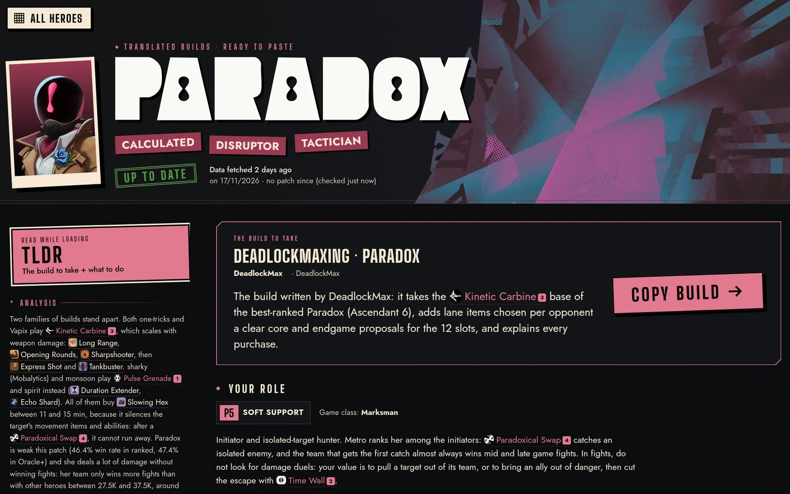
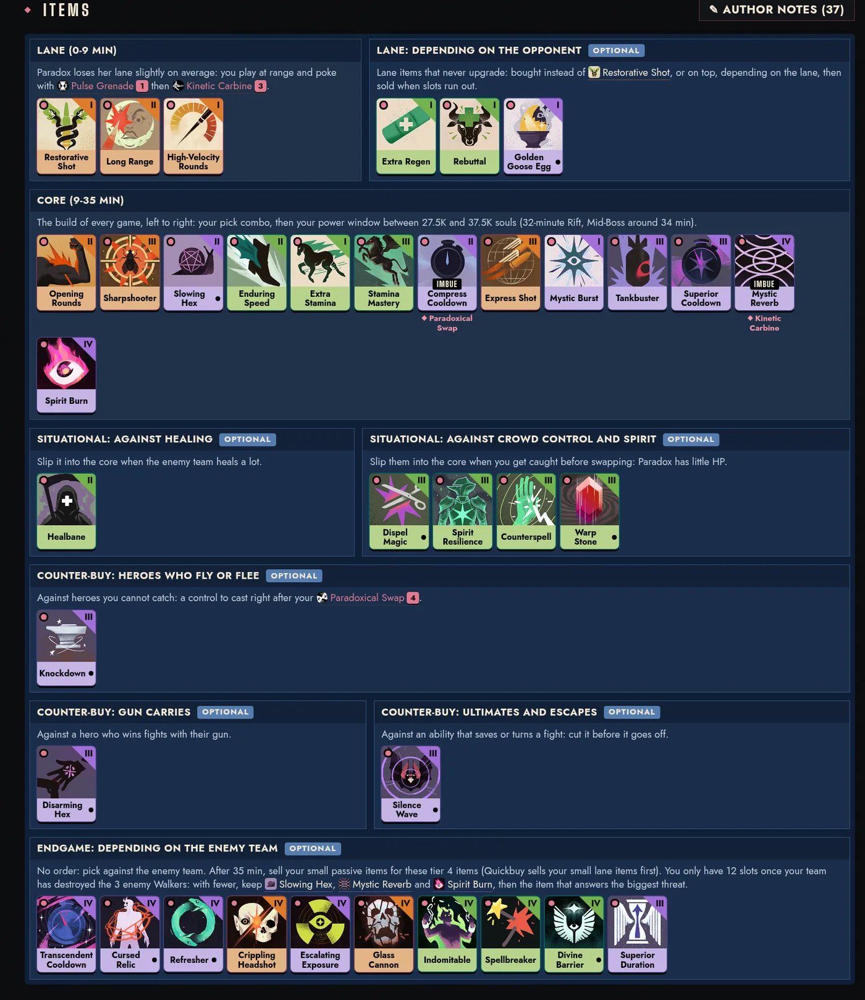
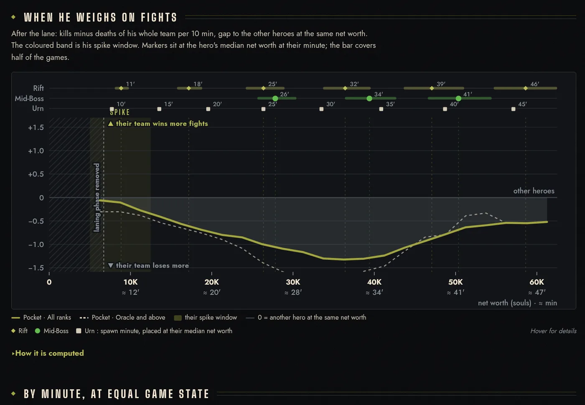
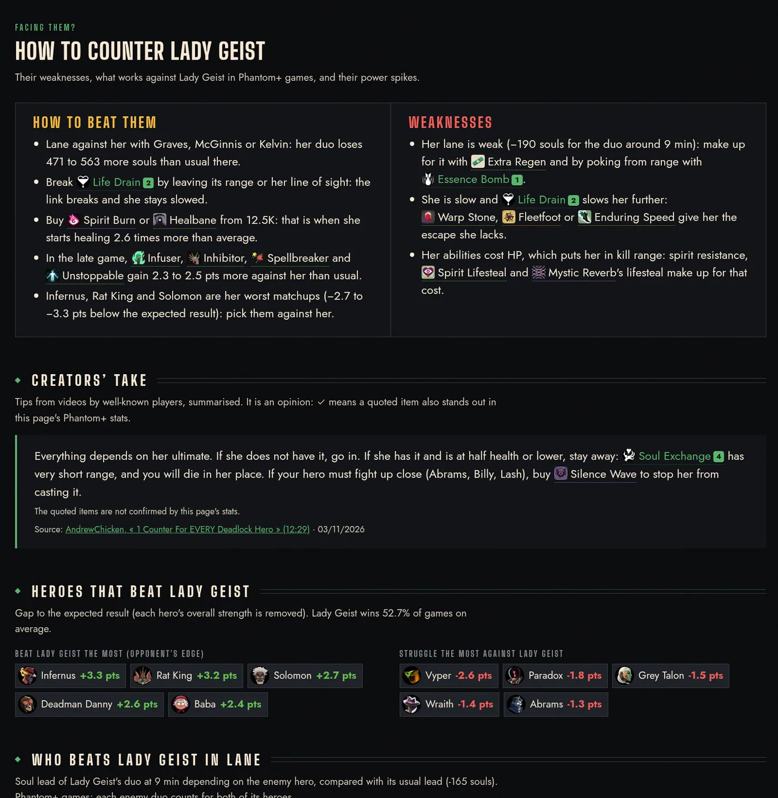
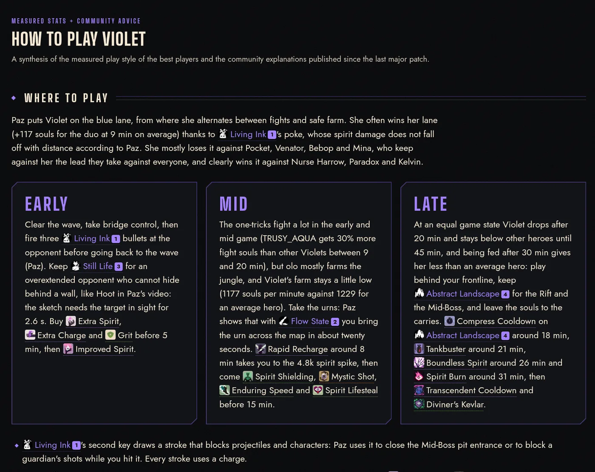
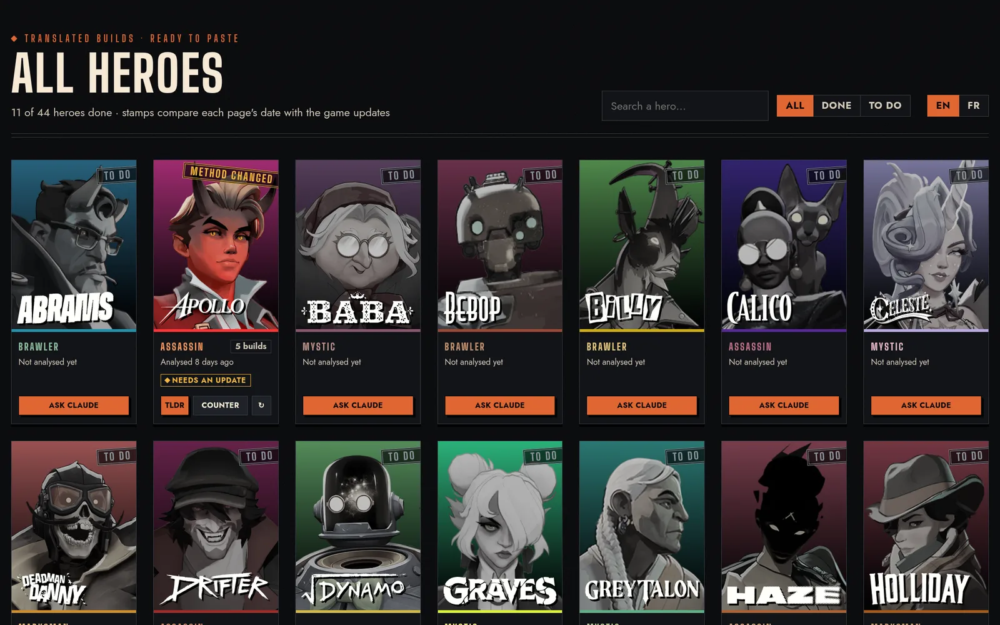
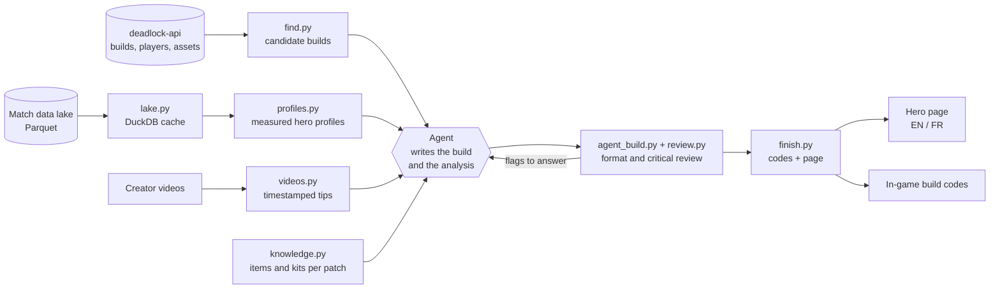

<div align="center">


# deadlock-maxing

**Data-driven Deadlock builds, written by an agent and checked against match data.**

A [Claude Code](https://claude.com/claude-code) plugin that measures how every hero really plays, then writes a
build with an explanation for each purchase. It generates a web page (English and French) with build codes you
paste straight into the game.

[](https://github.com/KentoPAC/deadlock-maxing/actions/workflows/ci.yml)


[](LICENSE)

**[Live demo](https://kentopac.github.io/deadlock-maxing/examples/)** ·
[French version](https://kentopac.github.io/deadlock-maxing/examples/index.fr.html) ·
[Paradox page](https://kentopac.github.io/deadlock-maxing/examples/search-paradox/) ·
[Pocket page](https://kentopac.github.io/deadlock-maxing/examples/search-pocket/)



</div>

## What it does

Ask *"Find me the best Pocket builds"*. A few minutes later you get a page that:

- **collects the builds of strong players**: high-ranked one-tricks, rebuilt from their real purchases and
  timings, plus expert, community and creator builds;
- **measures the hero** on tens of thousands of ranked matches: lane, power spike window, value of being fed,
  farm, and the effect of each item at equal game state;
- **writes a DeadlockMax build** that crosses all of this with the hero's kit. A critical review checks it against
  the data before it is published;
- **explains how to play and how to counter the hero**, with every sentence linked to its sources;
- **exports in-game build codes** in the game's own clipboard format: one click, then "Paste build" in game.

<table>
<tr>
<td width="50%"></td>
<td width="50%"></td>
</tr>
<tr>
<td><b>The build</b>, drawn with the game's own layout: lane, core with buy minutes, situational and counter-buy
categories, endgame proposals. Every item has a note.</td>
<td><b>The data</b>: team fight impact by net worth against every other hero, the power spike window and the
impact by minute at equal game state.</td>
</tr>
<tr>
<td></td>
<td></td>
</tr>
<tr>
<td><b>How to counter</b>: weaknesses, creator tips with timestamps, matchups normalised against the expected
result, lane results by opponent, counter items measured from matches.</td>
<td><b>How to play</b>: lane, early / mid / late game plan, ability tips, measured play style against the
average of the best players.</td>
</tr>
</table>

<p align="center"></p>

## How it works



Scripts compute facts and raise flags; the agent decides. Building a good item order is a judgement call, so no
script picks items. Instead, the scripts make sure every judgement is confronted with the numbers.

## Data analysis

The statistics run on a local DuckDB cache of the public deadlock-api match data lake: about 60,000 ranked matches
per window, with per-player snapshots every few minutes, exact death times and objectives.

- **Comparisons at equal game state.** A hero that wins more when ahead says little. Each measure compares the
  hero with every other hero *at the same net worth* (or the same minute and team soul lead), so the curve shows
  when the hero itself is strong, not when its team is.
- **Power spike window.** Team fight impact (enemy deaths minus ally deaths around the hero) by 2,500-soul net worth
  bucket, against all heroes. The window where the hero outperforms decides its role: an early spike makes an
  early-game hero, whatever the late trend.
- **Lane.** Kills minus deaths before the lane's first guardian falls and the duo's soul lead at that moment,
  normalised by opponent, to say who wins the lane against the hero and which lane items help.
- **Items at equal souls.** An item's win rate is compared with every purchase of the same hero in the same net
  worth bucket, weighted by bucket. This removes the bias of late, expensive items bought by teams that already
  win. Each flag shows its sample size, so 600 games never outweigh 13,000.
- **Shop investment steps.** The shop grants a stat bonus per column of invested souls, with a large step at
  4,800 souls. The review computes when the build reaches each step, an upgrade replacing its component in the
  invested value. It compares that timing with the hero's most liked public builds.
- **Patch awareness.** Matches mix games from before and after a balance change. Items changed during the data
  window are listed from the official patch notes, and a build cannot use them without an explicit review.

## Agent guardrails

The DeadlockMax build is written by the agent, then refused until it passes the checks:

- **Format**: every item has a note saying when and why to buy it, components come before their upgrades, imbued items
  name their ability, and the text uses only characters the game accepts. Each category description stays under
  the game's 1,024-byte limit, and the build code under 16,000 bytes.
- **Critical review** (`review.py`): items absent from every good build, items present in most of them but
  missing here, and items that lose at equal souls each raise a flag. Shop steps reached late raise one too.
  Each flag needs a written answer: a fix or a reason.
- **Writing checks** (`writing.py`, `textlinks.py`): official item and ability names, no filler, no game basics,
  every sentence linked to its sources.
- **Kit facts** are checked against the wiki and the patch notes, not raw asset fields, which can be outdated.

## Build codes

The game exports builds as `base64(zstd(protobuf CMsgHeroBuild))`. `codec.py` encodes and decodes this format
with the standard library only (a small protobuf writer and Python 3.14's `compression.zstd`). Category sizes are
recomputed so translated text is never cut, the categories are placed in rows like the game's, and authors are
anonymised (author id 0).

## Install

DeadlockMax is a [Claude Code plugin](https://code.claude.com/docs/en/plugins). Its skills are namespaced
`deadlockmax:<skill>`; generated pages go to the project's `builds/` folder.

```text
/plugin marketplace add KentoPAC/deadlock-maxing
/plugin install deadlockmax@deadlockmax
```

Or for one project only, as a repository plugin (loads in place, no install step):

```sh
cd my-deadlock-project
git clone https://github.com/KentoPAC/deadlock-maxing.git .claude/skills/deadlockmax
```

| Skill | Used for |
| --- | --- |
| `deadlockmax:hero-page` | Hero pages: builds, the DeadlockMax build, how to play, how to counter |
| `deadlockmax:stats` | Measured statistics: lane, power spikes, farm, healing, item effects at equal game state |
| `deadlockmax:knowledge` | What every item and ability does, items grouped by effect, refreshed per patch |
| `deadlockmax:build-code` | One build link or code: translation and in-game paste code |
| `deadlockmax:analyze` | One match, or a player's games compared with the same mode, ranked and Oracle+ players |
| `deadlockmax:videos` | Tips from creator YouTube videos, with timestamps |

Requirements: Python 3.14+, `wl-copy` (Wayland) or `xclip` (X11) to copy codes. Optional: [uv](https://docs.astral.sh/uv/)
for the statistics (DuckDB, pinned in `uv.lock`, capped at 3 GB of RAM) and
[`yt-dlp`](https://github.com/yt-dlp/yt-dlp) to import creator videos.

## Usage

Talk to Claude Code in the project:

| You say | What happens |
| --- | --- |
| *Find me the best Pocket builds* | Finds candidates, writes the analysis and the build, opens `builds/search-pocket/index.html` |
| *How do I counter Vindicta?* | Same page, opened on the counter view |
| *When is Paradox strong?* | Power spike window, lane and fights from the measured profile |
| *Translate this build: deadchaps.gg/builds/123456* | Translates one build and copies its code |
| *Open the all heroes page* | `builds/index.html`: every hero and the state of its page |

Requests work in French too (*"Trouve-moi les meilleurs builds Pocket"*).

The scripts can also be run directly:

```sh
S=.claude/skills/deadlockmax
python3 -I $S/scripts/find.py mina builds/search-mina      # candidates + analysis data
python3 -I $S/scripts/review.py builds/search-mina         # critical review of the DeadlockMax build
python3 -I $S/scripts/report.py builds/search-mina         # regenerate the page
python3 -I $S/scripts/codec.py --decode "$(wl-paste -n)"   # inspect a code copied in game
(cd $S && uv run --extra stats python -I scripts/lake.py)       # match data cache (~1 min, ~1 GB)
(cd $S && uv run --extra stats python -I scripts/profiles.py)   # hero profiles (~2 min)
python3 -I $S/scripts/charts.py pocket                     # the measured profile as text charts
```

## Project layout

```
.claude-plugin/     plugin.json (the plugin manifest) and marketplace.json (install from GitHub)
skills/<name>/      one SKILL.md per skill: the workflow, writing rules and sources Claude follows
scripts/
  Data
    lake.py         local DuckDB cache of recent ranked matches from the deadlock-api data lake
    profiles.py     measured profile of every hero (lane, spike window, fed value, farm, item effects)
    charts.py       text charts of a profile, for the terminal and the in-game power line
    laning.py       who and what wins the lane against the hero
    playstyle.py    measured play style against the Phantom+ average
    matchups.py     matchups and items that beat the hero
    counterplay.py  counter items by enemy composition
    counters.py     items one-tricks buy against specific heroes
    patchnotes.py   items and heroes changed during the data window
  Builds
    find.py         build candidates (one-tricks, Mobalytics, community, creators)
    fetch.py        one build by id or URL
    agent_build.py  checks and encodes the build written by the agent
    review.py       critical review: shop steps, good builds, win rate at equal souls
    apply.py        translations -> build code, category layout, clipboard
    codec.py        build code encoder / decoder
  Pages
    finish.py       one call: translations + analysis -> codes + page
    report.py       hero page assembly
    hub.py          home page with every hero
    tooltips.py     in-game style item and ability tooltips
    writing.py      writing checks (filler, game basics)
    textlinks.py    links in written texts, shortened-name check
    status.py       method version, completeness, sources
  Knowledge
    knowledge.py    items by effect and hero kits, per patch
    guides.py       community guides (in-game builds, Steam guides)
    roles.py        game class, meta position, statistical profile
    videos.py       creator video tips (YouTube subtitles)
    i18n.py         localized strings
    common.py       API access and shared helpers
locales/            interface strings, one file per language (en, fr)
templates/          hero page and home page (HTML, CSS, JS)
examples/           generated pages, published as the live demo
data/               analysis method versions, creator video tips
tests/              unit tests (no network)
```

## Languages

Every page is generated in **English** (`index.html`) and **French** (`index.fr.html`), with an **EN | FR** switch
that keeps the current view. Interface strings live in `locales/<lang>.json`, item and ability names come from the
API in the page language, and the analysis and every build code exist in both languages. Adding a language means
adding a locale file and an entry in `i18n.LANGS`.

## Development

```sh
./check.sh   # ruff + unit tests, the same checks as CI
```

Any change to how information is gathered or written adds a version to `data/changelog.json`: existing pages then
list what changed and offer a targeted update. See [CONTRIBUTING.md](CONTRIBUTING.md) for branch and commit
conventions.

## Data and credits

- Match statistics, builds and game assets: [deadlock-api.com](https://deadlock-api.com).
- Community guides: [Steam Community](https://steamcommunity.com/app/1422450/guides/).
- Creator tips: credited and linked on each page (e.g. AndrewChicken).

Deadlock is a trademark of Valve Corporation. This project is not affiliated with or endorsed by Valve.

## License

[MIT](LICENSE)
